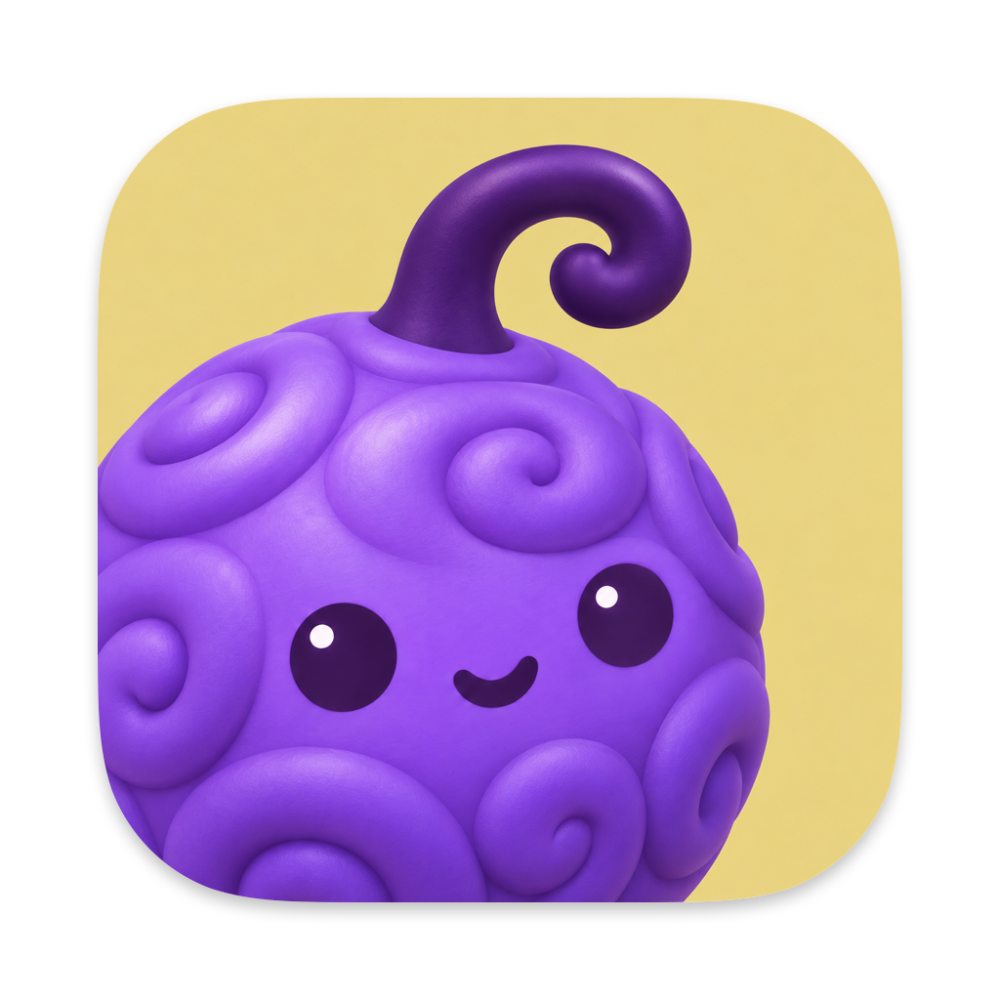
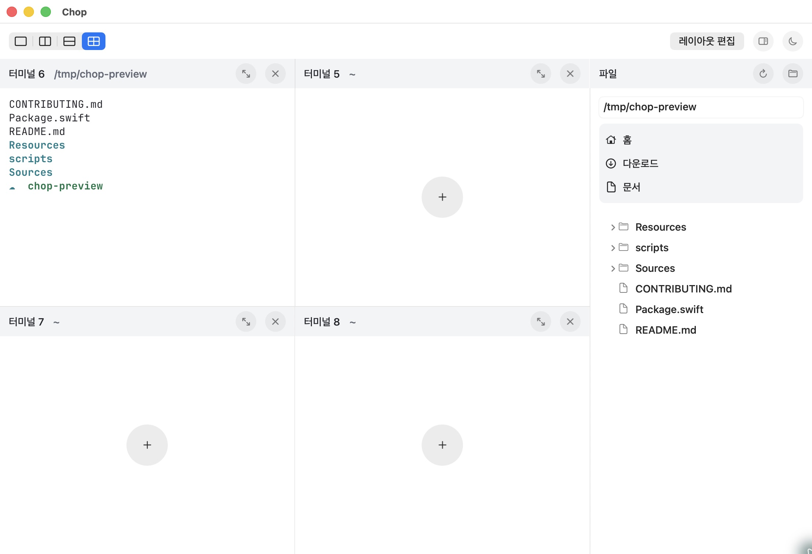
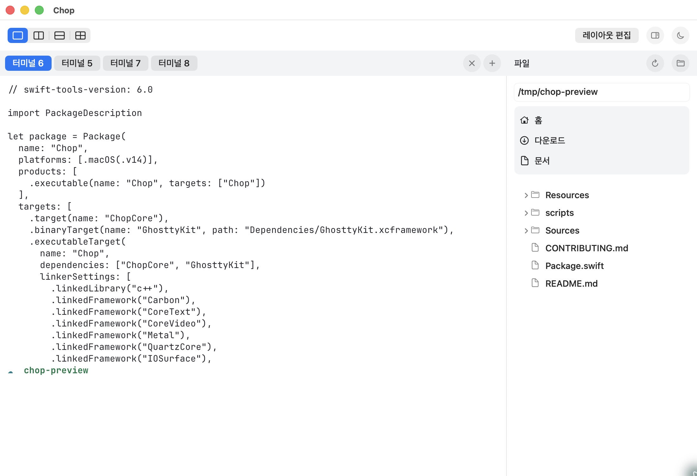

<div align="center">
  

  <h1>Chop</h1>

  <p>원하는 칸에 터미널을 추가하고, 나눠 쓰는 macOS 앱</p>

  <p>
    빈 칸의 <strong>+</strong>로 시작하고,<br />
    탭·좌우·상하·격자로 작업에 맞게 펼칩니다.
  </p>

  <p>
    
    
    
    
    <a href="https://github.com/safethecode/chop/actions/workflows/ci.yml"></a>
  </p>

  <p>
    <a href="#주요-기능">주요 기능</a> ·
    <a href="#레이아웃">레이아웃</a> ·
    <a href="#시작하기">시작하기</a> ·
    <a href="#단축키">단축키</a> ·
    <a href="#기여하기">기여하기</a>
  </p>
</div>

<p align="center">
  <picture>
    <source media="(prefers-color-scheme: dark)" srcset="./docs/images/chop-dark.jpg" />
    
  </picture>
</p>

<p align="center">
  <sub>실제 Chop 실행 화면 · <a href="./docs/images/chop-light.jpg">라이트</a> / <a href="./docs/images/chop-dark.jpg">다크</a></sub>
</p>

## Chop은?

Chop은 여러 셸을 한 창에서 다루는 macOS 네이티브 터미널 앱입니다.
Swift와 AppKit으로 만들고, [Ghostty](https://github.com/ghostty-org/ghostty)의
libghostty 엔진과 Metal 렌더러를 사용합니다.

처음 열면 2×2로 나눈 네 칸 중 **터미널 1이 바로 실행**됩니다. 나머지 칸은 중앙의 `+`를
누를 때 열립니다. 터미널을 더 추가하거나 배치를 바꾸면서 각 칸에서 작업을 이어갈 수 있습니다.

이름은 버기의 동강동강 열매에서 가져왔습니다. 하나의 창을 동강동강 나눠 여러 터미널로 쓰는
모습에서 출발했습니다.

## 주요 기능

| 기능 | 설명 |
| --- | --- |
| 칸에서 바로 추가 | 빈 칸 중앙의 `+`로 터미널을 엽니다. 편집 모드에서는 실행 중인 칸 옆이나 아래로 추가합니다. |
| 네 가지 보기 | 상단 탭, 좌우, 상하, 격자로 전환하며 기존 터미널을 모두 유지합니다. |
| 자유로운 배치 | 분할 경계를 드래그해 크기를 바꾸고, 편집 모드에서 칸을 끌어 자리를 바꿉니다. |
| 한 칸에 집중 | 현재 칸을 크게 보거나 원래 배치로 돌아갑니다. 다른 셸의 작업은 계속됩니다. |
| 라이트·다크 모드 | 상단의 달·해 아이콘으로 전환합니다. 터미널 색상도 함께 바뀌며 선택을 기억합니다. |
| 오른쪽 파일 트리 | 경로 입력, macOS 폴더 선택기, 홈·다운로드·문서 바로가기로 폴더를 탐색합니다. |
| 경로 드래그 입력 | 파일이나 폴더를 터미널에 놓으면 셸 인자로 인용한 경로를 입력합니다. Enter는 보내지 않습니다. |
| 작업 공간 복원 | 배치·이름·경로·선택한 칸을 저장하고, 다음 실행 때 새 셸로 엽니다. |

한글 입력, 텍스트 선택, 스크롤백, 복사·붙여넣기를 지원합니다. 실행 중인 작업을 닫을 때는
확인하며, 셸이 종료된 칸은 다시 `+`로 열 수 있습니다.

헤더의 **이름이나 연필 아이콘**을 누르면 터미널 이름을 바꿉니다. 상단 탭 보기에서는 탭을
우클릭해 **이름 바꾸기…**를 선택합니다. `⌘⇧R`도 사용할 수 있으며 바꾼 이름은 다음 실행에도 유지됩니다.

## 레이아웃

상단 왼쪽의 네 아이콘으로 보기를 바꿉니다.

| 보기 | 배치 |
| --- | --- |
| 탭 | 모든 칸을 상단 탭으로 유지하고 선택한 터미널 하나를 크게 표시합니다. |
| 좌우 | 열린 칸을 가로로 나란히 배치합니다. |
| 상하 | 열린 칸을 세로로 쌓습니다. |
| 격자 | 모든 칸을 여러 행에 나눠 배치합니다. 기본은 2×2입니다. |

터미널이 많아도 보기 전환 때문에 셸을 닫지 않습니다. 칸은 최대 16개까지 추가할 수 있고,
최소 크기인 280×180pt를 넘는 배치는 가로·세로 스크롤로 탐색합니다. 키보드로 포커스를
옮기면 해당 칸이 보이도록 스크롤합니다.

**레이아웃 편집**을 켜면 실행 중인 칸 중앙에도 추가 버튼이 나타납니다. 헤더의 이동 손잡이를
다른 칸으로 드래그하면 칸 전체 미리보기가 따라오고, 놓은 자리로 이동합니다. 셸과 실행 중인
프로세스는 유지됩니다. 빈 칸을 닫으면 인접 칸과 합쳐지며 마지막 한 칸은 남습니다.

<p align="center">
  
  <br />
  <sub>넓게 볼 때는 탭으로. 다시 나눌 때도 기존 터미널은 그대로.</sub>
</p>

## 파일 트리

파일 트리는 공통 툴바 아래, 터미널 오른쪽에서 열립니다. `⌘⇧E`로 표시하거나 숨기고,
경계를 드래그해 폭을 조절합니다. 경로를 입력한 뒤 Enter를 누르거나 `⌘O`로 macOS 폴더
선택기를 열어 탐색할 폴더를 지정합니다.

폴더를 펼칠 때 하위 항목을 읽고, 폴더부터 정렬합니다. 숨김 항목은 제외하며 심볼릭 링크와
앱 패키지는 펼치지 않습니다. 파일을 더블 클릭하면 Finder에서 선택하고, 우클릭 메뉴나
`⌘C`로 경로를 복사합니다. 실행 중인 터미널 본문으로 드래그해 경로를 넣을 수도 있습니다.

파일 트리의 탐색 경로와 터미널의 작업 경로는 독립적입니다. 마지막 폴더와 패널 표시 여부,
폭은 다음 실행에도 유지됩니다. 읽기에 실패하면 경로 수정·폴더 선택·바로가기·새로고침으로
다시 시도할 수 있습니다.

## 시작하기

### 요구 사항

- macOS 14 이상
- Xcode 16 이상 / Swift 6 이상
- Xcode Command Line Tools (`xcode-select -p`로 확인)

### 소스에서 실행

```sh
git clone https://github.com/safethecode/chop.git
cd chop
./scripts/run.sh
```

첫 빌드는 공식 Ghostty 소스와 Zig 0.14.1을 내려받아 libghostty를 컴파일합니다.
Metal 도구가 없으면 Xcode의 공식 MetalToolchain 구성 요소도 준비합니다. 이후에는 캐시를
재사용합니다. 고정 버전과 빌드 환경 안내는 [의존성 문서](Dependencies/README.md)에 있습니다.

디버그 앱은 `build/debug/Chop.app`에 생성됩니다. 이미 Chop이 실행 중이면 기존 앱을
활성화하므로, 변경한 코드를 실행하려면 먼저 앱을 종료합니다.

### 릴리스 앱 만들기

```sh
./scripts/build-app.sh release
```

`build/release/Chop.app`이 생성됩니다. 빌드 후 바로 실행하려면 `./scripts/run.sh release`를
사용합니다. 현재는 개발용 임시 서명을 사용하며 외부 배포용 Developer ID 서명과 공증은
포함하지 않습니다.

## 단축키

| 동작 | 단축키 |
| --- | --- |
| 현재 칸에서 터미널 열기 / 닫기 | `⌘T` / `⌘W` |
| 오른쪽 / 아래로 나누기 | `⌘D` / `⌘⇧D` |
| 레이아웃 편집 | `⌘⇧L` |
| 파일 트리 보기 / 숨기기 | `⌘⇧E` |
| 파일 트리의 폴더 선택 | `⌘O` |
| 인접 칸으로 이동 | `⌘⌥방향키` |
| 편집 중 인접 칸과 자리 바꾸기 | `⌘⌥⇧방향키` |
| 현재 칸 확대 / 전체 배치 복귀 | `⌘⇧Enter` |
| 현재 칸 이름 변경 | `⌘⇧R` |
| 스크롤백 맨 위 / 맨 아래 | `⌘↑` / `⌘↓` |
| 한 페이지 위 / 아래 | `⇧Page Up` / `⇧Page Down` |
| 윈도우 닫기 | `⌘⇧W` |

탭 보기에서는 탭의 `+`로 추가하고 `⌘W`로 선택한 탭을 닫습니다. 분할 보기의 빈 칸에서
`⌘W`를 누르면 그 칸을 제거합니다.

## 데이터 저장과 복원

작업 공간은 Mac 안에 JSON 파일로 저장합니다.

```text
~/Library/Application Support/Chop/
└── session.json
```

레이아웃, 분할 비율, 칸 이름, 작업 경로, 열림 상태, 선택한 칸과 탭 보기 여부를 자동 저장합니다.
앱을 다시 열면 열려 있던 칸에 **새 셸**을 실행합니다. 이전 프로세스, 셸 변수, 화면 내용과
명령 기록은 저장하거나 재실행하지 않습니다. 셸의 시작 설정과 히스토리는 사용자 설정을 따릅니다.

- 작업 폴더가 없거나 열 수 없으면 알림 후 홈 폴더로 대체합니다.
- 손상되거나 지원하지 않는 저장 파일은 `session-unreadable-<UUID>.json`으로 보존합니다.
- 저장 실패 시 터미널 메뉴의 **레이아웃 다시 저장**으로 재시도합니다. 저장하지 못한 채 종료하려면 확인을 거칩니다.
- 창을 직접 닫으면 그 안의 터미널을 닫습니다. 앱 종료는 마지막으로 열려 있던 칸의 상태를 저장한 뒤 셸을 종료합니다.

## 기술 구성

| 영역 | 사용 기술 |
| --- | --- |
| 앱과 UI | Swift 6, AppKit, SF Symbols |
| 터미널 엔진 | libghostty, Metal |
| 레이아웃과 저장 | 분할 트리, Codable, 로컬 JSON 파일 |
| 빌드 | Swift Package Manager, 셸 스크립트 |
| 검증 | swift-format, Swift Testing, 실제 셸 통합 테스트 |
| CI | GitHub Actions · macOS |

libghostty는 Ghostty v1.2.3의 특정 커밋으로 고정합니다. 엔진과 입력 어댑터의 연결 방식,
패치와 라이선스 고지는 [Dependencies/README.md](Dependencies/README.md)에 기록합니다.

## 개발과 검증

```sh
./scripts/check.sh
```

Swift 포맷, 셸 문법, 앱 메타데이터, 릴리스 빌드, 앱 서명과 번들 아이콘을 검사한 뒤 테스트를
실행합니다. GitHub Actions도 같은 명령을 사용합니다. 테스트는 분할·병합·저장 복구와
실제 셸의 출력·상태 유지·탭 전환·경로 드롭 등을 다룹니다.

Xcode에서 편집하려면 `./scripts/prepare-ghostty.sh`를 실행한 뒤 `Package.swift`를 엽니다.
개발과 PR 절차는 [CONTRIBUTING.md](CONTRIBUTING.md)를 참고해 주세요.
검증 환경과 미확인 범위는 [검증 기록](design/review.md)에 남깁니다. macOS 14 실기기와
전체 VoiceOver 탐색, 마우스 휠의 실기 동작은 아직 검증하지 못했습니다.

## 프로젝트 구조

```text
Sources/
├── Chop/             # 앱, 창, 터미널 입력과 렌더링, 파일 트리
└── ChopCore/         # 분할 모델, 경로 처리, 작업 공간 저장
Tests/
├── ChopTests/        # 실제 셸과 AppKit 통합 테스트
└── ChopCoreTests/    # 레이아웃과 저장·복구 테스트
Resources/            # 앱 아이콘, macOS 메타데이터, 터미널 테마
Dependencies/         # Ghostty 고정 버전, 패치와 빌드 결과
scripts/              # 의존성 준비, 빌드, 실행, 검증
.github/              # CI와 PR 템플릿
docs/images/          # 실제 앱 스크린샷
design/               # 디자인 기준과 검증 기록
```

## 기여하기

버그 제보와 기능 제안은 [Issues](https://github.com/safethecode/chop/issues)에 남겨 주세요.
문제가 생긴 macOS 버전, 재현 순서와 기대한 동작을 함께 적어 주시면 도움이 됩니다.

PR은 한 기능이나 수정 단위로 작게 나눕니다. 기본 검증은 `./scripts/check.sh`이며,
UI를 바꿨다면 실제 앱에서 확인한 화면과 동작을 기록합니다.
자세한 절차는 [기여 가이드](CONTRIBUTING.md)를 따릅니다.

현재 터미널·레이아웃·파일 트리·화면 모드·복원을 구현했습니다.
알림, Git 브랜치 표시, CLI와 브라우저·에이전트 연동은 후속 범위입니다.

## 바탕이 된 프로젝트

- [Ghostty](https://github.com/ghostty-org/ghostty) — libghostty 터미널 엔진과 macOS 입력 처리의 기반입니다. [라이선스 고지](Resources/Ghostty-LICENSE)를 보존합니다.
- [cmux](https://github.com/manaflow-ai/cmux) — 작업 공간과 기능 구성에서 영감을 받았습니다.

앱 아이콘의 원본과 재생성 방법은 [AppIcon 문서](Resources/AppIcon.md)에 있습니다.

---

<div align="center">
  <sub>원하는 만큼 나누고, 한 창에서 이어서.</sub>
</div>
