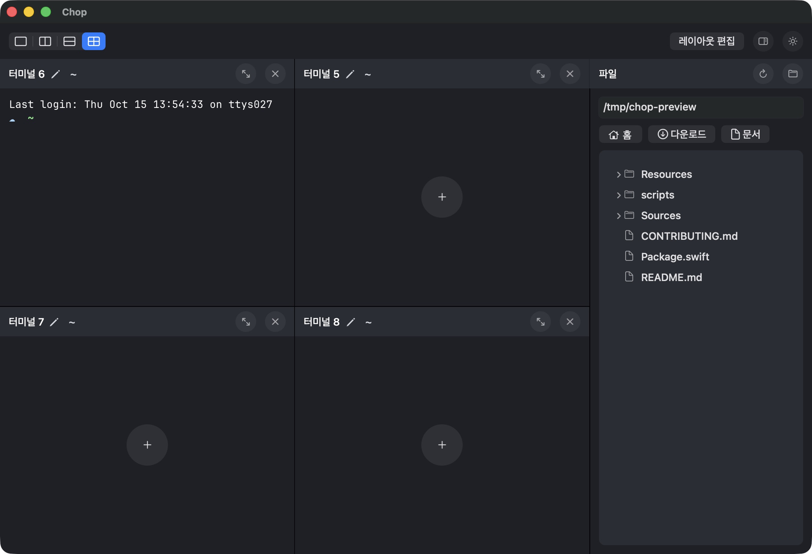
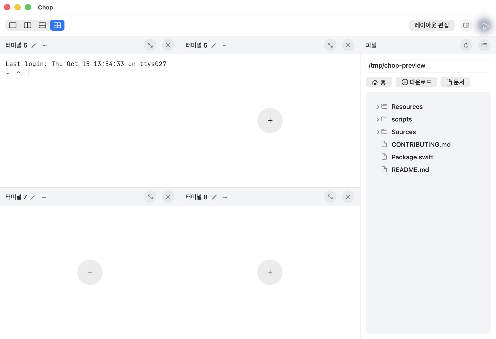

# 파일 탐색 바로가기 행과 목록 배경

## 출처와 현재 계약

- R-PANEL-ROW: [사용자 바로가기 crop](../references/file-shortcuts-row-user.png),596×254 image px. 큰 중립 배경에 홈/다운로드/문서가 세로로 놓여 있다. 사용자는 이 세 목적지를 가로 row로 배치하도록 후속 요청했다.
- R-PANEL-BUTTON: [사용자 레이아웃 편집 버튼 crop](../references/layout-edit-button-user.png),238×82 image px. 이름을 감싸는 중립색 둥근 버튼이 조작 가능함을 나타낸다. 원본 DPR/전체 창 크기는 미확인이며 image px를 native pt 실측값으로 등치하지 않는다.
- D-ROW / E-LOCATIONS: 기존 세로108pt 묶음 대신,경로 필드 아래에 높이28pt/gap8pt의 개별 native rounded 버튼을 한 줄로 둔다. 상단 편집 버튼과 같은 NSButton bezelStyle/font를 재사용한다. 이전 요청의 SF house/arrow.down.circle/doc 의미와14pt medium 글자는 유지한다. 아이콘–이름의 세부 간격/버튼 내부 여백은 AppKit image-leading 배치에 맡긴다. 세로 행의 동일 아이콘 열/이름 시작선 계약은 이번 가로 배치 요청으로 대체한다.
- D-LIST / E-CONTENTS: 실제 파일 목록과 로딩/빈/오류 안내를 같은 목록 면 안에 둔다. headerBackground(light F3F4F6/dark292D35)를 fileListBackground라는 의미 별칭으로 재사용한다. 반경8/내부 inset8,바깥 좌우·하단 inset12와그룹 간8은 제품 선택/기존 스케일이다. 색상 추가·반복 제목·장식 구분선·새 모션은 없다.

## 구현과 검증

- 사용자 지정 변경 범위: 바로가기의 세로→가로/개별 버튼 표현과파일 목록 배경이다. 실제 경로/tooltip/AX 이름/target-action,NSOutlineView 데이터·선택·펼치기·드래그 writer,비동기 로딩/세대 취소 코드는 유지했다. 커스텀 버튼 내부 label/icon view와 hitTest는 native NSButton으로 대체했다.
- 실제 앱: 기본1100×752pt와최소842×442pt(파일 패널280pt)를 두 모드에서 확인했다. 세 버튼의 전체 이름·아이콘이 한 줄에 들어가며 기존 파일/터미널 헤더40pt 정렬과 경로 입력의 포커스 테두리 없음이 유지됐다. 예전108pt 묶음이28pt 행으로 줄어 파일 목록에 더 많은 세로 공간이 남는다.
- 실제 이동: 홈→문서→다운로드 버튼을 눌러 각 root path 변경을 확인했다. 이후 공개 프로젝트 복사본/tmp/chop-preview로 돌아가 두 모드 사진을 촬영했다. 개인 Downloads 목록은 공개 증거에 포함하지 않는다.
- 상태: 별도 빈 임시 폴더와없는 하위 경로를 경로 입력/새로고침으로 열어‘빈 폴더예요’와두 줄 오류가 목록 면 안에 보이며 불필요한 손잡이가 없는 것을 확인했다. 오류 뒤 공개 프로젝트 경로로 복구됐다. 실제 긴 Downloads 목록의 손잡이는 유지된다.
- 입력 범위: 실제 포인터 파일 선택/드래그를 시도했지만 이번 CUA 좌표 클릭은 창을 찾지 못하는 오류를 반환했고 새로운 드래그 성공을 확인하지 못했다. 따라서 이번 실행에서 파일 드래그를 재검증했다고 표현하지 않는다. 창 연결 갱신과도구 재초기화 후에도 같은 입력 제약이 있었으며,앱 자체 결함으로 단정하지 않는다. 별도 AppKit NSWindow 검사는280pt 최소 폭의두 모드에서 세 버튼 전체가 보이고 같은 행에 놓이며 각 중심 hitTest가 해당 버튼으로,파일 행 중심 hitTest가 실제 outline 내부로 도달하는 것을 확인한다. 기존 경로 드래그/문자 처리 검사는 그대로 통과했다.
- 자동 검사: 새 최소 폭/행 클릭 영역 회귀를 포함한 전체27개 검사5.617초,check.sh의strict format/릴리스 빌드/서명 검증 통과(.cache/check-file-browser-surfaces-final.log). 상수를 반복하는 스타일 검사가 아니라 native 최소 폭/문자 잘림/입력 경계를 검사한다.
- 종료 확인: 기본 크기 복원을 위해 재실행하려다 현재 터미널의 종료 확인이 떠 취소했다. 기존 작업을 종료하지 않았다. 창 크기는포인터 resize로 기본1100pt에 복구했다. 검증용 탐색 위치는 최종 Downloads로 복구했고 다크/격자/기존 이름6·5·7·8과실행/빈 상태는 유지한다.
- 재사용 범위: 변경하지 않은 파일 데이터·명령 미실행 드래그·터미널 수명 검증의 이전 기록은 보존한다. 이번에 바뀐 버튼/목록 면/빈·오류/최소 폭은 위 실제 화면·실제 이동·새 native hit-test 검사를 근거로 추가 판독했다. 전체 VoiceOver/모든 포인터 환경을 새로 검증했다고 주장하지 않는다.

## 실제 화면

