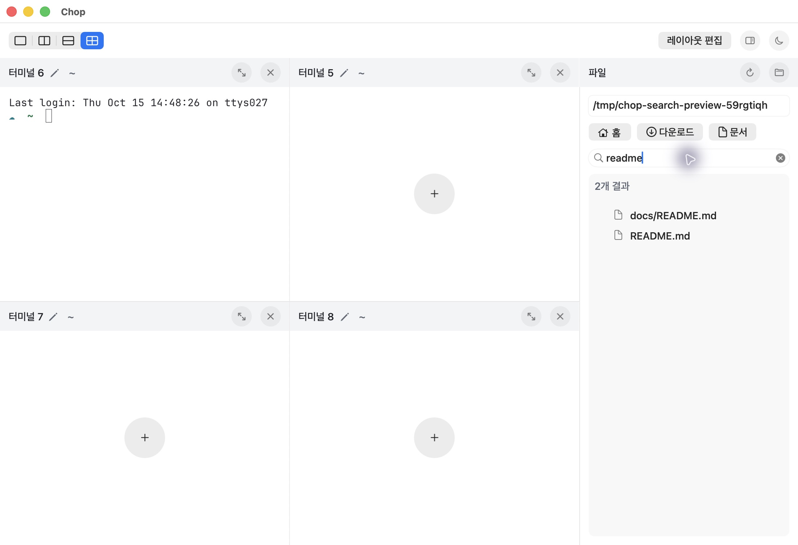
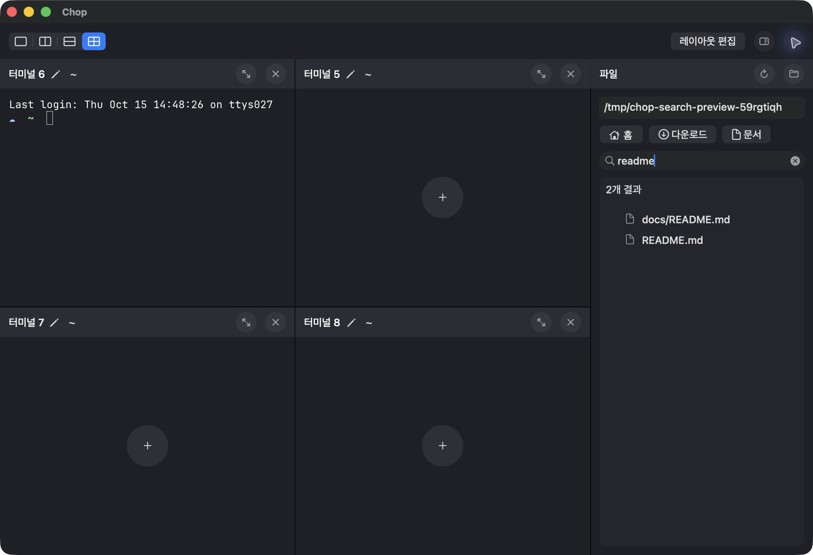
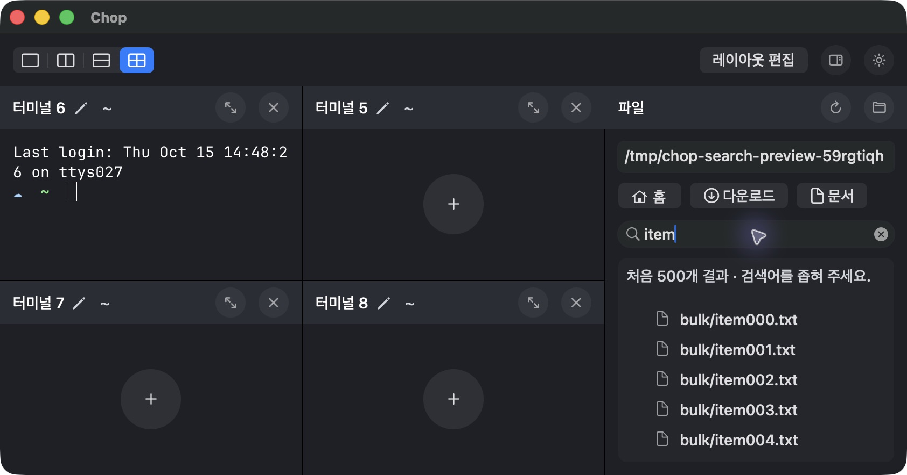
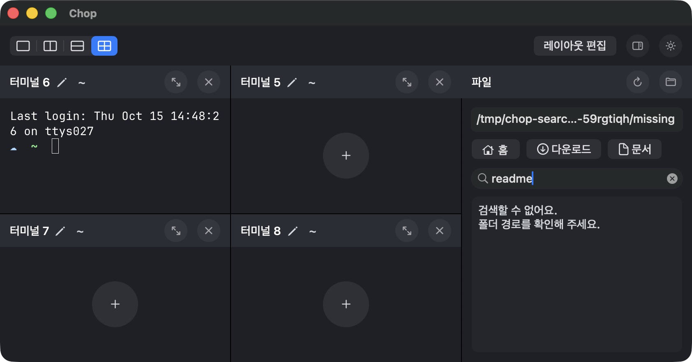

# 파일트리 이름 검색

## 기준과 요소 관계

- R-SEARCH: 사용자의 “파일트리 안에서 검색” 요청. 기존 가로 바로가기와 연한 파일 목록 면은 유지하고,그 사이에서 현재 루트의 하위 파일·폴더를 이름으로 찾는다. 파일 내용 검색은 이번 범위 밖이다. 새 외부 화면 레퍼런스를 임의로 만들지 않았으며 검색 컨트롤은 기존 AppKit 체계의 reviewer-derived 선택이다.
- E-SEARCH / D-SEARCH:28pt NSSearchField를 경로28pt→바로가기28pt→검색28pt→목록 순으로 배치한다. 기존 바깥 inset12/그룹 gap8/14pt medium/목록 내부 inset8/반경8을 유지한다. 상단 공통 툴바와40pt 파일·터미널 헤더의 위계는 바꾸지 않는다. 검색/지우기 아이콘·caret은 native 컨트롤에 맡기고 입력 포커스 테두리는 표시하지 않는다.
- E-RESULTS / D-RESULTS: 같은 outline과 연한 fileListBackground에 상대 경로를 표시한다. URL 문자열에서 루트 접두사를 잘라내지 않고 순회 중 상대 경로를 기록해 /tmp·/var의 Foundation 정규화에도 동명 파일이 구분된다. 툴팁·복사·드래그 데이터는 실제 파일 URL을 사용한다. 폴더 결과는 더블클릭/Enter로 해당 폴더를 열고 검색어를 지운다. 검색 지우기는 현재 루트의 일반 트리로 복구한다.
- D-READ:200ms debounce,새 검색/탐색/뷰 해제 시 취소,세대 ID로 늦은 응답 무시. 기존 detached 폴더 reader를 재사용하며 숨김/심볼릭 링크·패키지 하위는 읽지 않는다. 표시 이름과 실제 파일명 모두 대소문자 구분 없이 찾는다. 처음500개 뒤 추가 일치가 있을 때만 초과를 알리고,읽을 수 없는 하위 폴더는 건너뛰었다고 알린다. 루트 자체의 실패는0건과 구분한다.

## 상태 문구 계약

| C-ID / 조건 | 최종 문구 / 위치 | 사실·다음 행동과 검증 |
|---|---|---|
| C-SEARCH-INPUT / 비어 있는 입력 | 파일·폴더 이름 검색 / native placeholder | 검색 범위는 tooltip에 현재 폴더와 하위 폴더로 설명. 별도 중복 설명 행은 두지 않는다. 최소280pt에서 읽을 수 있다. |
| C-SEARCH-READ / debounce·읽기 중 | 검색 중… / 목록 상태 | 가짜 진행률·완료 시간을 만들지 않는다. |
| C-SEARCH-COUNT / 완료 | N개 결과 / 목록 상태 | 실제 반환한 수를 한 번 표시한다. 동명 README 두 경로의 실제 결과와 일치했다. |
| C-SEARCH-EMPTY /0건 | 검색 결과가 없어요 / 목록 상태 | 오류와 구분하고 native 지우기로 일반 트리에 복귀한다. 실제0건·지우기 복구를 확인했다. |
| C-SEARCH-LIMIT /501번째 일치 | 처음500개 결과 · 검색어를 좁혀 주세요. / 목록 상태 | 실제501개 fixture에서500개와 안내를 확인했고 item499까지 스크롤했다. 최소 폭에서 안내와 결과가 겹치지 않는다. |
| C-SEARCH-PARTIAL /하위 읽기 실패 | 일부 폴더를 읽지 못했어요. / 결과 상태 다음 줄 | 읽은 결과를 유지한다. 가짜 원인을 덧붙이지 않으며 reader 실패 자동 검사로 확인했다. |
| C-SEARCH-ERROR /루트 읽기 실패 | 검색할 수 없어요. + 실제 오류 / 목록 상태 | 없는 경로에서 “폴더 경로를 확인해 주세요.”가 함께 표시되고,경로 수정·바로가기로 복구한다. 최소 창의 두 줄을 실제 확인했다. |

쉬운 이름/직접 동작/조건과 수량 보존/중복 설명 제거를 기준으로 한국어 문구를 검토했다. ‘일시적’ 같은 원인이나 해결 시간을 발명하지 않았다. 모든 새 읽는 UI는 기존14pt medium이며 작은 글자 예외는 추가하지 않았다.

## 검증과 수정 이력

- base19331e1,구현3ba9a9e/b8e43d3. 최종 check.sh32개 검사7.818초,strict format·릴리스 빌드·서명·아이콘 검사 통과(.cache/check-file-tree-search-final-head.log).
- 코어: 중첩/한글/자연 정렬/표시명과 실제명/숨김·패키지·심볼릭 링크 루프 제외,정확한 제한과 초과,하위 실패 유지·루트 오류,진행 중 취소·공백 검색의 읽기 없음. UI: native target-action→검색,상대 경로/동명 파일,각 결과 URL과 해당 파일의 식별자 일치,새로고침 검색 유지,지우기/폴더 Enter/탐색 초기화,늦게 끝난 검색 무시,두 모드의 최소280pt 컨트롤·파일 행 hit-test를 확인했다. NSURL/URL의 /private/var 표현 차이는 실제 파일 식별자로 비교했다.
- F-SEARCH-RELATIVE-PATH: 첫 구현의 접두사 제거가 canonical URL에서 실패해 두 README가 같은 이름으로 보였다. 테스트에서 실패를 확인하고 순회 상대 경로로 고쳤다. 최종 실제 앱에서도 docs/README.md와 README.md가 구분된다.
- F-SEARCH-KEYBOARD: 실제 Tab→Down→Return이 선택만 하고 폴더를 열지 않던 상태를 발견했다. plain Return/keypad Enter를 기존 doubleAction에 연결한 뒤 native key event 검사와 실제 앱에서 폴더 열기/검색 초기화를 확인했다.
- 실제 앱: 기본1100×752pt와최소842×442pt(파일 패널280pt),두 모드의 새 최종 커밋 화면을 확인했다. 공개 fixture에서 입력에 따른 갱신,대소문자/동명 경로/한글 붙여넣기,0건과지우기 복구,키보드 폴더 열기,501개 제한/끝 스크롤,루트 오류/경로·다운로드 복구를 실행했다. 최종 검색 입력은 같은 텍스트를 field editor에 다시 쓰지 않도록 해 caret/조합을 유지한다. 실제 한국어 IME의 모든 조합 경로를 새로 검증했다고 주장하지 않는다.
- 파일 드래그: 실제 포인터 드래그를 시도했지만 CUA가 noWindowsAvailable을 반환하거나 경로 삽입이 나타나지 않았다. 이번 실행의 포인터 드래그 종단 성공은 미확인이다. 이전 파일 드롭 검증 기록과 현재 outline writer/터미널 입력 구현은 유지하며,새 결과별 native URL과 실제 파일의 동일성은 자동 검사했다. 이 제한을 새 드래그 성공으로 표현하지 않는다.
- 최종 앱은 라이트 모드·기존 다운로드 루트·검색어 없음·기본 창 크기로 복구했다. 공개 캡처에는 개인 Downloads 항목을 포함하지 않았다. 이전 레이아웃/셸/파일 드롭의 검증 범위는 역사적 기록으로 보존한다.

## 실제 최종 커밋 화면

