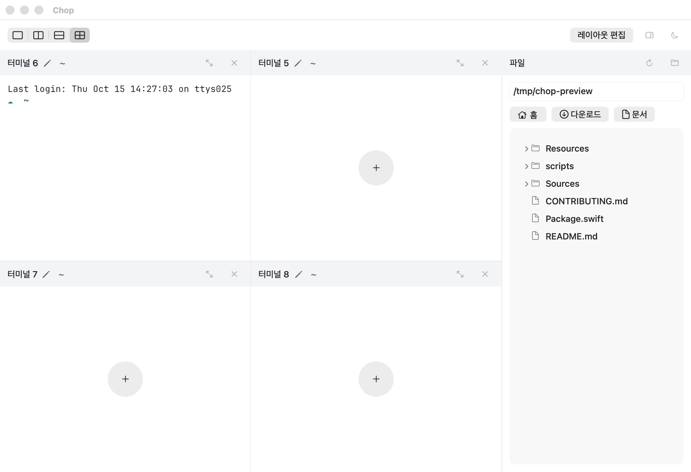
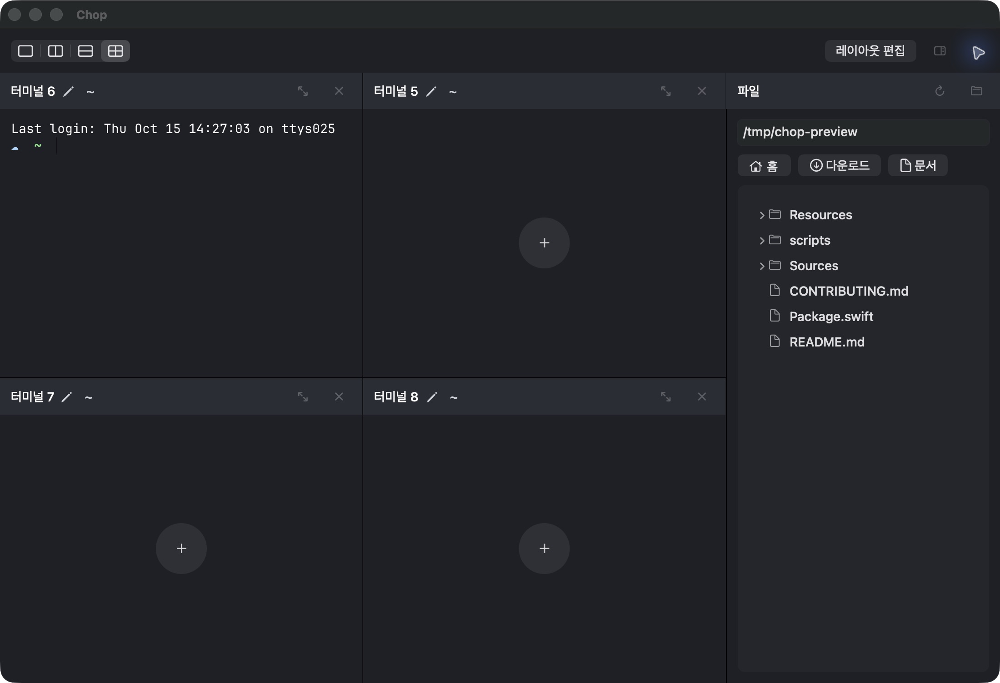

# 파일 목록의 연한 중립 배경

## 사용자 교정과 관계

- R-SOFT: 사용자는 목록 배경을 홈·문서 버튼색에 맞추라고 요청한 뒤, 실제 적용을 보고 “너무 색상이 이상해 더 옅었으면 좋겠어”라고 교정했다. 최신 지시에 따라 버튼과 같은 중립 계열을 유지하면서 넓은 목록 면의 대비를 낮춘다.
- O-INITIAL: 이전 헤더색 별칭은 light F3F4F6/dark292D35였다. 버튼 기본 면을 그대로 확대한 첫 시도는 light ECECEC/dark303136로,넓은 면이 너무 강하다는 사용자 교정을 받았다. 첫 시도를 최종 승인으로 취급하지 않는다.
- D-SOFT / E-CONTENTS: 최종 fileListBackground는 light F8F8F8/dark24262C다. 버튼 기본 면을 본문 쪽으로 약35%만 반영한 제품 선택이며 OS가 보장하는 native 색 토큰이라고 주장하지 않는다. 버튼 자체의 native hover/pressed/focus,헤더와 터미널 본문색은 유지한다.
- Q-SOFT: ‘버튼과 완전히 같은 RGB’였던 중간 기준을 ‘같은 중립 계열,본문보다 조금만 구분되는 연한 면’으로 대체한다. 버튼·파일 목록 관계의 사용자 교정이며 공통 스킬의 보편 색상으로 승격하지 않는다.

## 실제 검증

- base a18485c부터 AppearanceMode.fileListBackground의두 색만 변경했다. 소비 위치는 FileBrowserView.listSection 한 곳이며 목록/로딩/빈/오류가 같은 면을 공유한다. 레이아웃·글자·상태 로직·경로 입력·드래그 구현 변경은 없다.
- release 앱을 다시 실행해1100×752pt,공개/tmp/chop-preview 목록을 두 모드에서 직접 확인했다. 버튼보다 약한 면으로 파일 목록 소속이 구분되고,이름/아이콘 대비와 기존40pt 헤더 정렬·한 줄 바로가기가 유지된다. native 스크린샷의2배 배율은 코드의pt 실측값이 아니다.
- ./scripts/check.sh 전체27개 검사5.515초,포맷·빌드·서명 검사 통과(.cache/check-file-tree-soft-color.log). 색상 상수를 반복하는 새 테스트는 추가하지 않았다. 기존 두 모드/최소280pt 버튼·파일 행 hit-test도 통과했다.
- 이번 수정의 시각 판독은 아래 새 캡처가 근거다. 이전 가로 배치/경로·빈·오류/드래그 검증 기록은 역사적 범위로 보존하며,이번 색 변경만으로 새로운 포인터 드래그 성공을 주장하지 않는다. 이후 검색은 별도 PR이다.

